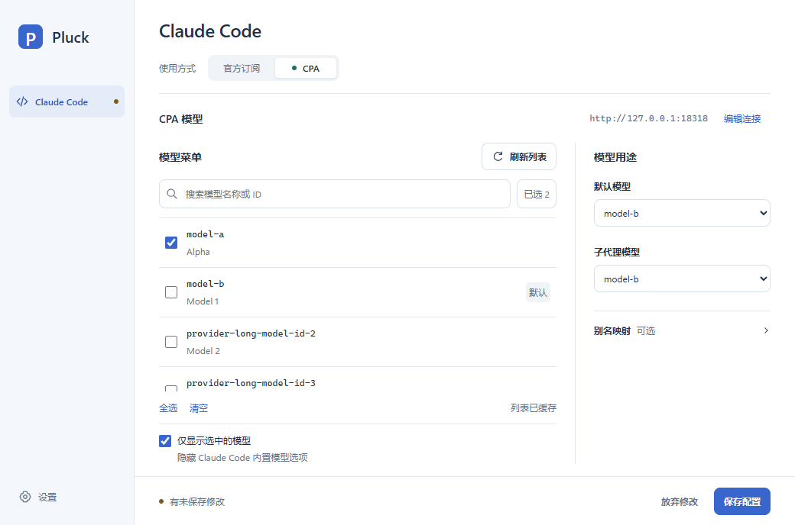
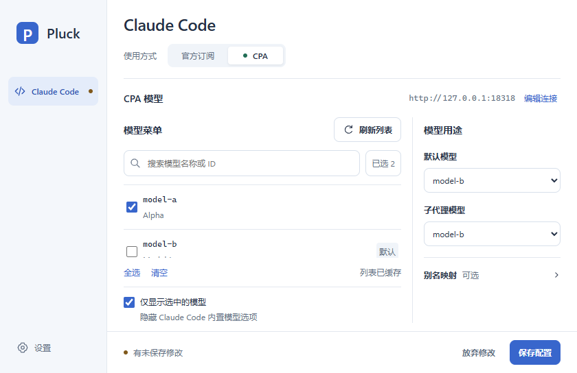
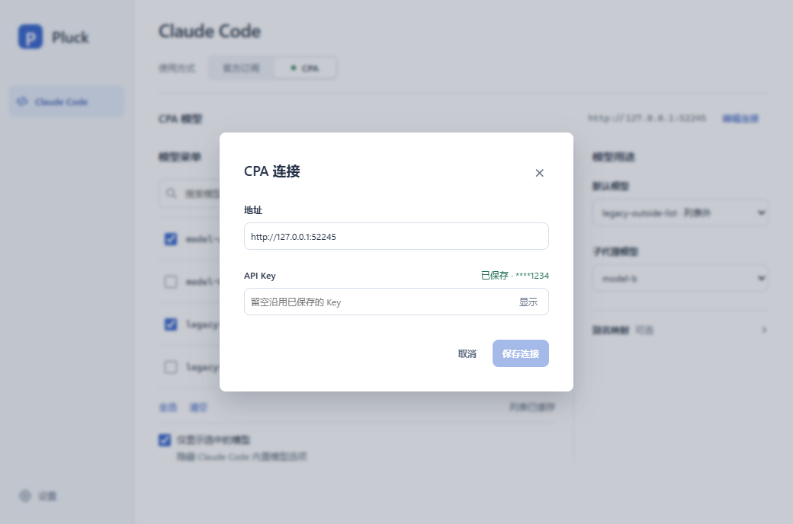
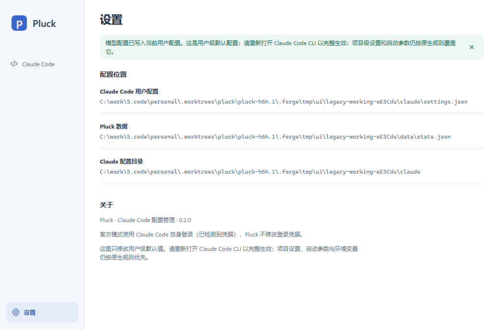

# 单页界面 0.2.0 验证与交付

日期：2026-10-28。任务：pluck-h6h.1。代码交付目标：main；独立 AI 审核后由任务协议落地。实际视觉、流畅度与原生焦点体验由后续使用者任务 pluck-h6h.2 判断。

## 产物

[Forge 交付材料（exe、校验值、对应提交与报告）](https://192.168.30.11:3674/board/#/materials/0420268735d50977e7da69342a1dc79b)

- 文件：`pluck-0.2.0-windows-x64.exe`，5,105,664 字节，PE Machine 0x8664；ProductVersion / FileVersion 均为 0.2.0。
- SHA-256：`e8ebd7a1a2b46e83f9196bfd54d1780488454a178cc6494e79cdff01f61f35e9`。
- 实现提交：`a3656aefd44aa454c9b83a1283c4d6525339fcc8`。后续交付文档提交不改动生产代码；最终审核提交在材料中登记。
- Windows 10/11 x64，使用系统 WebView2；下载后直接运行，无需安装 Pluck。`--hidden` 只启动托盘。
- 正常运行读写真实的用户配置；希望在隔离数据下体验时，先在自己的 PowerShell 中设置独立 `CLAUDE_CONFIG_DIR`、`PLUCK_DATA_DIR`，再启动 exe。勿用本机真实配置做验证试验。

## 验收结论

| 验收 | 本次证据与结果 |
| --- | --- |
| A1 / V1 | 生产 dist 在独立无头 Edge 156.0.4314.50 中检查；内容区 1040×688 与 840×544，无全页横向溢出，单个业务导航，设置置底，分栏、折叠与固定保存区可达，多模型在列表区滚动。见下方截图。生产窗口使用系统标题栏，默认 1040×720，最小 840×576。 |
| A2 / V2 | 首次连接/获取/选择/保存/明确启用，以及已有配置的名称和 ID 搜索、已选筛选、默认/子代理/三种别名、仅显示选中项均通过；全选保留原已选的列表外 ID。官方模式可编辑 CPA 预设，保存连接不自动切换。 |
| A3 / V3 | 保存/取消连接、设置往返和刷新保留模型草稿；无编辑跟随外部值，有编辑保留原草稿与版本。重复通知及无关设置变化不误报模型冲突；相关变化、尚未通知的冲突与晚到读取/刷新均不把旧草稿换成新 revision。连接未编辑跟随、已编辑保留并显示重新载入入口；同尾号不同 Key 也会改变连接版本。 |
| A4 / V4 | 生产组件通过 Tauri 关闭事件边界检查继续编辑/保存/放弃；服务失败或冲突阻止切换和销毁，输入保留。连接失败也阻止关闭；写入期间禁止重复关闭、Escape 或重复提交。Tab 约束、Escape 和焦点返回通过无头检查。原生干净窗口关闭及 WebView 回收由隐藏生产工厂测量验证。 |
| A5 / V5 | 新控件通过当前 Rust pluckctl 读写旧版固定样本的临时副本，保留旧模型 ID、已有 Key、快照、凭据和无关字段，保存用户选择。样本由旧基线 2dd03c2 的 pluckctl 生成，生成顺序见 fixtures/legacy-cpa/README.md。损坏/其他连接/获取失败可见。持久格式未变。 |
| A6 / V6 | 本次源代码构建的新免安装 exe、哈希、提交、截图、UI 行为报告与隐藏资源记录同材料交付。架构和使用说明已更新。H1 原生视觉与焦点感受留给 pluck-h6h.2。 |

## 检查

- `pnpm install --frozen-lockfile`：新检出按锁文件安装；本任务增加 playwright-core 供独立无头检查，未增加 Forge 准备配置。
- `pnpm build`：类型检查与 Vite 生产构建通过，最终前端资产 `index-BzQZx6tl.js` / `index-C2IJUrZb.css`；release 与资源入口使用同一份生产前端。
- `pnpm verify:ui` 和最终 `node scripts/verify-ui.mjs`：共 21 组通过，详见 [行为报告](single-page/report.json)。受控故障和竞态只替换 IPC 边界，实际生产 React 组件、事件订阅与 Tauri 窗口 API 路径保持不变；旧样本场景使用真实 Rust 服务，而非假保存。
- `pnpm test:rust`：28 项通过（13 项核心单元测试，15 项服务回归），包含同尾号 Key 冲突、连接保存前后模型基准、无关设置变化保留、旧版固定样本、Key 变化后拒绝晚到模型列表及既有安全报错。
- `pnpm tauri build --no-bundle`：Windows x64 release 成功；本次只交付免安装 exe，不要求 NSIS 安装器。
- `pnpm measure:resources --report .forge/tmp/resources-single-page.md`：复用生产后台与 create_window，独立实例、配置和 WebView 目录，全程隐藏且不获取焦点。5 轮关闭后均回到 1 个后台进程，专用内存 55.9–56.0 MiB，2 秒空闲 CPU 增量均为 0；创建请求 971–2323 ms，关闭请求约 25 ms。完整数据见 [隐藏资源记录](single-page/resources.md)。
- `git merge --no-ff main`：实现分支已含当前 main，未发生冲突；落地前仍按协议确认目标最新 tip。
- `git diff --check`：通过。原生模型映射未改，因此不重复运行 CLI 兼容检查。

## 截图

以下是生产前端的无头截图，使用隔离测试数据；不是用户桌面截图，也不代替原生使用体验。

标准内容区：

紧凑内容区：

旧版固定隔离样本的连接弹窗：

设置：

## 验证边界

本次未操作用户鼠标、托盘或其他窗口，未读写真实 Claude/Pluck 数据，未启动真实 Claude CLI。无头检查不证明原生窗口的感官效果；隐藏测量只证明本次五轮回收及短期稳定范围，不能证明长期零泄漏。正常依赖与构建产物位于任务工作区；测量和无头浏览器的独立外部临时目录由脚本清理。
